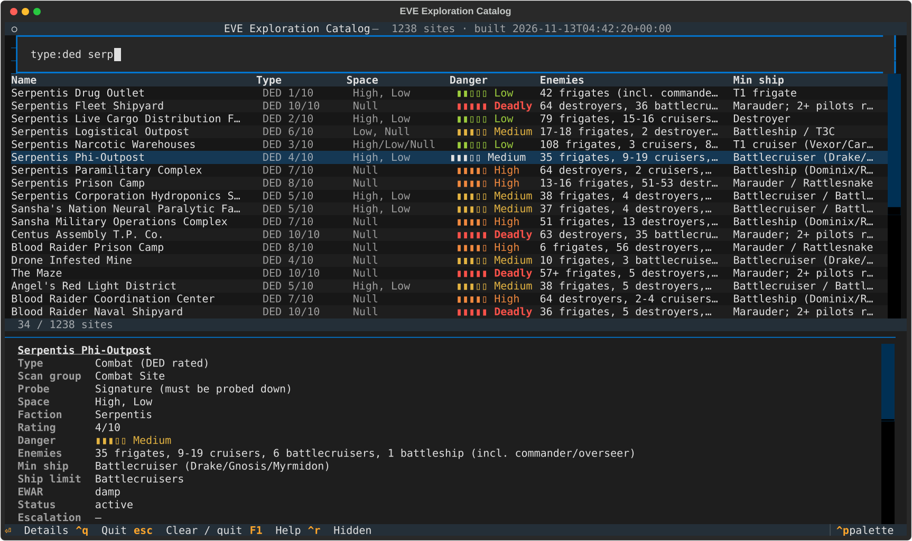
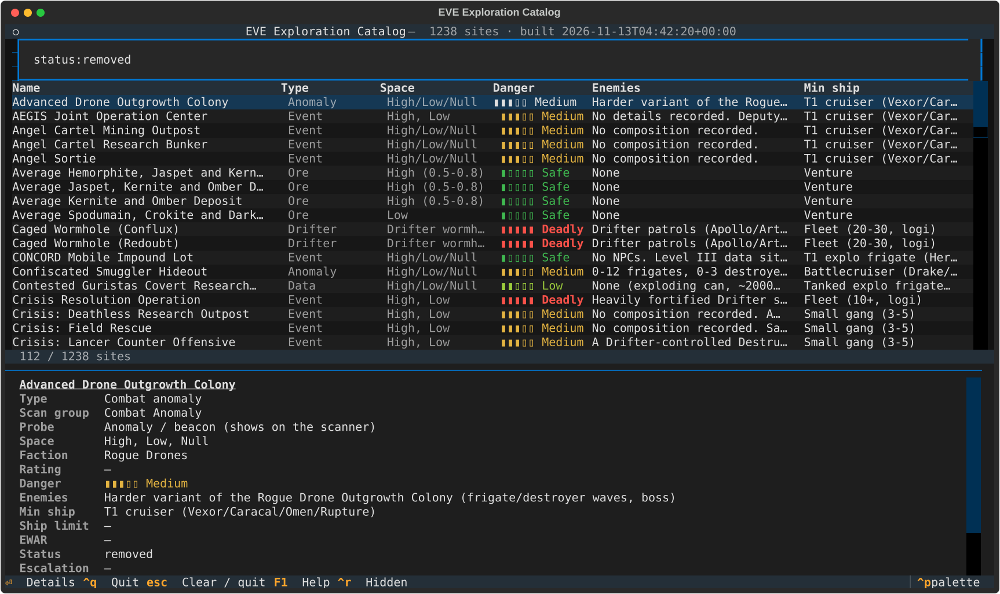
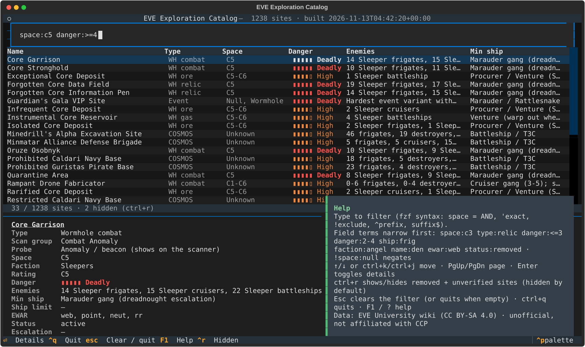

# expo-catalog

Every EVE Online exploration site in one searchable terminal table.

[](https://github.com/grimmy0/expo-catalog/actions/workflows/ci.yml)
[](LICENSE)
[](LICENSE-DATA)
[](https://www.python.org/downloads/)

A terminal UI catalog of every EVE Online cosmic signature and anomaly, with
fzf-style filtering. It covers known space, wormhole space (C1–C6, Thera,
shattered and Drifter systems) and Pochven: DED-rated and unrated combat
sites, data, relic and gas sites, ghost sites, sleeper caches, chemical labs,
combat/ore/ice anomalies, Faction Warfare complexes, insurgency and homefront
sites, incursions, COSMOS complexes, wormhole connections and recurring event
sites. Each entry
shows how dangerous the site is, what you will be shooting (or dodging) and the
smallest ship that can reasonably run it.



## Quick start

New to Python tools? You only need [uv](https://docs.astral.sh/uv/) and Git;
uv takes care of Python and the other dependencies.

1. Install uv, using the commands from the
   [uv installation guide](https://docs.astral.sh/uv/getting-started/installation/):

   ```sh
   # macOS and Linux
   curl -LsSf https://astral.sh/uv/install.sh | sh
   ```

   ```powershell
   # Windows (PowerShell)
   powershell -ExecutionPolicy ByPass -c "irm https://astral.sh/uv/install.ps1 | iex"
   ```

   Package managers work too: `brew install uv` (Homebrew),
   `winget install --id=astral-sh.uv -e` (WinGet) or `scoop install main/uv`
   (Scoop). Open a new terminal afterwards so the `uv` command is found.

2. Install [Git](https://git-scm.com/downloads) if you do not have it; uv uses
   it to install from GitHub.

3. Install expo-catalog:

   ```sh
   uv tool install git+https://github.com/grimmy0/expo-catalog
   ```

   You do not need to install Python 3.15 yourself: by default uv downloads a
   Python version when it cannot find a suitable one on your system. Each uv
   release knows a fixed list of downloadable Python versions, so if uv says it
   cannot find Python 3.15, update uv (`uv self update` if you used the
   installer script, otherwise your package manager's upgrade command) and try
   again.

4. Run it:

   ```sh
   expo-catalog
   ```

   Start typing to filter the table. `F1` shows the help; `Esc` on an empty
   filter or `ctrl+q` quits. If the command is not found, see
   [Troubleshooting](#troubleshooting).

Update to the latest catalog with `uv tool upgrade expo-catalog`; remove it
with `uv tool uninstall expo-catalog`.

## Requirements

- Python 3.15 (uv downloads it if needed, see [Quick start](#quick-start))
- [uv](https://docs.astral.sh/uv/)
- Git, to install from GitHub

## Install

The [Quick start](#quick-start) covers the usual install. The catalog database
is bundled with the package, so an installed copy works without the checkout:

```sh
uv tool install git+https://github.com/grimmy0/expo-catalog   # from GitHub
uv tool install -e .      # from a checkout; editable, so `git pull` and --refresh update the data in place
expo-catalog              # now on PATH (~/.local/bin)
uv tool upgrade expo-catalog   # pick up a refreshed catalog
```

If `~/.local/bin` is not on your PATH, run `uv tool update-shell` once and open
a new shell.

## Run

From a checkout, without installing:

```sh
uv run expo-catalog                 # open the catalog
uv run expo-catalog --db PATH       # use another SQLite file (also: EXPO_CATALOG_DB=PATH)
uv run expo-catalog --all           # start with removed and unverified sites listed
uv run expo-catalog --refresh       # re-fetch the wiki and rebuild the database, then open it
uv run expo-catalog --version       # print the version and exit
```

Sites whose status is `removed` or `unverified` are hidden by default; the
status line counts them and `ctrl+r` toggles them. `--all` starts with them
listed, and a `status:` filter term (see below) always shows what it names.

<details>
<summary>Screenshot: removed sites listed with <code>status:removed</code></summary>



</details>

The database ships inside the package as `src/expo_catalog/data/catalog.sqlite`
(`expo_catalog/data/catalog.sqlite` once installed). If the database is missing
the command prints a hint and exits with status 1. `--refresh` runs
`python -m scraper refresh` from the repository root (network access needed), so
it needs a source checkout: an editable install (`uv tool install -e .`) or
`uv run`. From a regular install it exits with status 2; reinstall or
`uv tool upgrade expo-catalog` to pick up a refreshed catalog instead.

### Keys

| Key | Action |
| --- | --- |
| type | filter the table live |
| `↑` / `↓`, `ctrl+k` / `ctrl+j` | move the highlighted row (the filter keeps focus) |
| `PageUp` / `PageDown` | page through the table |
| `Enter` | toggle the detail panel |
| `Esc` | clear the filter; quit when it is already empty |
| `ctrl+r` | show / hide removed and unverified sites |
| `ctrl+q` | quit |
| `F1` / `?` | help |

<details>
<summary>Screenshot: the <code>F1</code> help</summary>



</details>

### Filter syntax

Terms are separated by spaces and must all match (AND). Matching is
case-insensitive and fuzzy by default; the best matches sort first, ties keep
alphabetical order.

| Term | Meaning |
| --- | --- |
| `serp outpost` | both terms match as subsequences |
| `'den` | exact substring |
| `!relic` | exclude texts containing `relic` |
| `^angel` | prefix match |
| `site$` | suffix match |

A `field:value` term (no spaces in the value) filters on one column before the
fuzzy terms rank what is left, so `space:c3 type:relic forgotten` lists only C3
relic sites, ordered by how well they match `forgotten`. `!field:value`
negates; `foo:bar` with an unknown field name is an ordinary fuzzy term.

| Field term | Meaning |
| --- | --- |
| `space:c3` | Space column: a token (`high`, `low`, `null`, `c1`..`c6`, `c13`, `wormhole`, `thera`, `shattered`, `pochven`, `drifter`), an alias (`hs`, `ls`, `ns`, `wh`, `j-space`, `k-space`) or any substring (`space:delve`). Ranges expand (`C1-C4` matches `c2`), a bare `Wormhole` matches every class, `Any`/`Various`/`Unknown` match everything |
| `type:relic` | Type label (`DED 3/10`, `WH relic`, `Anom T4`, `FW plex` …), category (`combat ded`, `wormhole relic`), scan group (`Data Site`) or rating |
| `danger:<=3` | danger level: `3`, `<3`, `>2`, `<=3`, `>=4` or a range `2-4`; labels work too (`danger:high`, `danger:safe-medium`) |
| `ship:frig` | substring of Min ship |
| `faction:angel` | substring of the faction |
| `name:den` | substring of the name |
| `ewar:web` | substring of the EWAR note |
| `status:removed` | substring of the status; also lifts the default hiding of removed / unverified sites |

### Examples

| Question | Filter |
| --- | --- |
| Find a site from a few letters of its name (best match first) | `phi outp` |
| What can I run in a frigate in a C3? | `space:c3 ship:frig` |
| Low-danger data sites in lowsec | `space:low type:data danger:<=2` |
| Highsec DED complexes rated Low danger or safer | `space:high type:ded danger:<=2` |
| Every Guristas DED complex, 1/10 to 10/10 | `type:ded faction:guristas` |
| Which gas sites spawn in a C5, and what guards them? | `type:gas space:c5` |
| Everything rated High or Deadly in a C5 | `space:c5 danger:>=4` |
| Relic sites outside nullsec | `type:relic !space:null` |
| Ore anomalies in Pochven | `space:pochven type:ore` |
| Ghost sites | `type:ghost` |
| Sites that no longer spawn, kept for reference | `status:removed` |

Sites whose Space is a plain `Wormhole` (the generic data and relic sites)
match every wormhole class, so they show up in `space:c3` searches next to the
C3-only sites.

<details>
<summary>Screenshot: <code>space:c3 type:relic</code></summary>


</details>

### Columns

- **Name**: exact in-game site name.
- **Type**: short category/rating label, e.g. `DED 3/10`, `Relic`, `WH gas`,
  `Anomaly T6`, `FW plex`, `COSMOS`.
- **Space**: where the site spawns (`High, Low`, `C3`, `Pochven`, …), truncated
  in the table and shown in full in the detail panel.
- **Danger**: a 0–5 bar coloured green to red.
  - `n/a` (0): no rating applies, e.g. wormhole connections.
  - `Safe` (1): no NPCs.
  - `Low` (2): a T1 frigate or destroyer handles it.
  - `Medium` (3): cruiser or battlecruiser territory.
  - `High` (4): battleship, T3 cruiser, marauder or a small gang.
  - `Deadly` (5): fleet-only or a capital-class threat.
- **Enemies**: NPC summary summed across all rooms and waves as documented on
  the wiki. The detail panel lists the per-wave rows.
- **Min ship**: the minimal viable ship for the site.

The detail panel (below the table) shows the full record: type, scan group,
whether it must be probed down, space, faction, rating, ship limit, EWAR,
status, escalation, loot note, description, source URL and the enemy waves.

## Troubleshooting

**`expo-catalog: command not found`** (or "not recognized" on Windows)

uv installs tool commands into its executable directory, usually
`~/.local/bin` on macOS and Linux and `%USERPROFILE%\.local\bin` on Windows;
`uv tool dir --bin` prints the one it uses. If that directory is not on your
`PATH`, run `uv tool update-shell` once and open a new terminal.

**`Git executable not found` while installing**

uv needs Git to install from a `git+https://` URL. Install
[Git](https://git-scm.com/downloads), check that `git --version` works in a new
terminal, then run the install command again.

**Colours look wrong, or the danger bars and borders are broken**

expo-catalog is built on [Textual](https://textual.textualize.io), which uses
true colour (16.7 million colours) where the terminal supports it.

- macOS: the built-in Terminal.app is limited to 256 colours and can draw box
  characters misaligned. Textual recommends iTerm2, Ghostty, Kitty or WezTerm
  instead. If you stay with Terminal.app, the
  [Textual FAQ](https://textual.textualize.io/FAQ/) suggests the Menlo Regular
  font with character spacing 1 and line spacing 0.805.
- The danger bar is drawn with the `▮` and `▯` characters. If they show up as
  empty boxes or question marks, your terminal font lacks them; switch to a
  font that has them.

**Windows**

Textual runs on Windows and recommends the new Windows Terminal. expo-catalog
has no platform-specific code, but CI only tests on Linux, so Windows and macOS
are not tested automatically. Please report anything that breaks.

**`Database not found at … — run: uv run python -m scraper.build`** (exit status 1)

The catalog file is missing. If you passed `--db PATH` or set
`EXPO_CATALOG_DB`, check the path in the message. For an installed copy,
reinstall it with `uv tool install --reinstall git+https://github.com/grimmy0/expo-catalog`;
in a checkout, the command in the message rebuilds the database from
`data/parsed_sites.json`.

**`Cannot refresh: … is not a source checkout`** (exit status 2)

`--refresh` rebuilds the bundled database in place, so it only works from a
checkout: `uv run expo-catalog --refresh`, or an editable install
(`uv tool install -e .`). An installed copy picks up new data with
`uv tool upgrade expo-catalog`.

**Still stuck?**

Open a
[bug report](https://github.com/grimmy0/expo-catalog/issues/new?template=bug_report.yml)
with the output of `expo-catalog --version`, your OS and your terminal. For
wrong or missing site data, use the
[data correction](https://github.com/grimmy0/expo-catalog/issues/new?template=data_correction.yml)
form.

## Data pipeline

```sh
uv run python -m scraper fetch   # refresh data/raw from the EVE University wiki API (git-ignored)
uv run python -m scraper parse   # data/raw -> data/parsed_sites.json
uv run python -m scraper build   # data/parsed_sites.json -> src/expo_catalog/data/catalog.sqlite  (--out PATH)
uv run python -m scraper refresh # all three in one go
```

The per-stage modules (`python -m scraper.fetch`, `.parse`, `.build`) still
work as well.

Besides the wiki cache, the pipeline reads these tracked, hand-maintained
inputs (a missing one is an error):

- `data/event_sites.json`: seasonal/live-event site research
- `data/npcwh_codes.json` + `data/Template_Whisk.wiki`: Sleeper NPC code table
  used to resolve `{{npcwh}}` rows, and the blue-loot values for `{{whisk}}`
- `data/wormholes.json`: wormhole connection types
- `data/systems.json`: security status and region of the systems COSMOS sites
  sit in (the Space column). `fetch` keeps it in step with the pages: it
  resolves newly mentioned systems through [ESI](https://esi.evetech.net) and
  drops ones no page names any more

### Keeping the catalog up to date

The wiki changes slowly but steadily. `data/wiki_state.json` records the
revision of every page the catalog was built from, so changes can be detected
without re-downloading anything:

```sh
uv run python -m scraper check              # exit 0: nothing changed, 1: changes, 2: API error
uv run python -m scraper check --json r.json
uv run python -m scraper refresh            # fetch -> parse -> build (also rewrites wiki_state.json)
uv run expo-catalog --refresh               # the same, then open the TUI
```

A page is tracked when it is in one of the site categories in `scraper/wiki.py`
(`SITE_CATEGORIES`), listed in `EXTRA_PAGES`, or uses the `{{CMBSiteInfo}}` site
infobox. The last rule catches site pages that lost (or never had) their topic
category; escalation destinations (Category:Expeditions), COSMOS agent pages,
Mercenary Den operations and the pages in `IGNORED_PAGES` are left out.

`check` lists NEW pages (tracked by those rules but not yet in the catalog),
REMOVED pages and CHANGED pages with a link to the wiki diff; changed pages that
have a hand-written entry in `scraper/curated.py` (`OVERRIDES`) are flagged so
the override can be re-reviewed.

The `Wiki refresh` GitHub Actions workflow (`.github/workflows/wiki-refresh.yml`)
runs `check` every Monday at 06:17 UTC (and on demand). When something changed
it runs `refresh` and the tests, then opens or updates a pull request on the
`auto/wiki-refresh` branch titled "Wiki refresh: N changed / M new pages" whose
body is the check report. Merge it after a glance at the flagged overrides.
The workflow needs "Allow GitHub Actions to create pull requests" enabled in
the repository settings.

Sources:

- [EVE University wiki](https://wiki.eveuniversity.org) (CC BY-SA 4.0, see
  [License](#license)) for site pages, NPC tables and escalations.
- EVE Ref reference data (derived from the SDE) for wormhole types.
- [ESI](https://esi.evetech.net) for the security status and region of COSMOS
  systems (`data/systems.json`).
- Hand-curated lists in `scraper/curated.py` for sites the wiki does not
  describe consistently.

Every site carries a `status`:

| status | Meaning |
| --- | --- |
| `active` | currently in the game |
| `removed` | no longer spawns, kept for reference (hidden in the TUI by default) |
| `event` | recurring or seasonal event site |
| `unverified` | known only from Singularity (test server) data or an uncertain name (hidden in the TUI by default) |

The schema lives in `src/expo_catalog/db.py` and is the single source of truth
for both the builder and the TUI.

## Tests

```sh
uv sync                                       # installs the dev tools (pytest, ruff)
uv run pytest -q
uv run ruff check src scraper tests           # lint
uv run ruff format --check src scraper tests  # formatting
```

Tests run offline; the TUI tests drive the app headless with Textual's
`App.run_test()`. CI runs the same commands on every push and pull request,
plus a [zizmor](https://docs.zizmor.sh) audit of the workflows.

## Layout

```
expo-catalog/
├── src/expo_catalog/
│   ├── __init__.py   # `expo-catalog` entry point
│   ├── app.py        # Textual app (table, filter, detail panel)
│   ├── db.py         # SQLite schema + read/insert helpers
│   ├── fuzzy.py      # fzf-style matcher
│   ├── labels.py     # Type / Space column labels
│   ├── query.py      # field:value filter terms
│   └── data/
│       └── catalog.sqlite  # the bundled catalog (ships in the wheel)
├── scraper/
│   ├── __main__.py   # `python -m scraper fetch|parse|build|check|refresh`
│   ├── fetch.py      # download wiki pages into data/raw
│   ├── parse.py      # wiki text -> data/parsed_sites.json
│   ├── build.py      # parsed sites -> src/expo_catalog/data/catalog.sqlite
│   ├── check.py      # wiki change detection against data/wiki_state.json
│   ├── curated.py    # hand-maintained site lists
│   ├── rules.py      # classification / danger rules
│   ├── systems.py    # COSMOS system security lookup (ESI -> data/systems.json)
│   └── wiki.py       # MediaWiki API client
├── data/             # pipeline inputs and intermediates (not shipped)
│   ├── event_sites.json     # hand-maintained event site research
│   ├── npcwh_codes.json     # hand-maintained Sleeper NPC codes
│   ├── Template_Whisk.wiki  # hand-maintained blue-loot table
│   ├── systems.json         # COSMOS system security/region cache
│   ├── parsed_sites.json
│   ├── wiki_state.json  # revision snapshot used by `scraper check`
│   ├── wormholes.json
│   └── raw/          # git-ignored wiki cache
├── docs/                # README screenshots, rendered from the real app
│   ├── screenshot.svg
│   ├── screenshot-help.svg
│   ├── screenshot-removed.svg
│   └── screenshot-wormhole.svg
├── tests/
├── .github/
│   ├── workflows/       # ci.yml, wiki-refresh.yml (weekly refresh PR)
│   ├── ISSUE_TEMPLATE/  # bug report, data correction, feature request forms
│   ├── dependabot.yml   # weekly GitHub Actions + uv updates
│   ├── pull_request_template.md
│   └── CODEOWNERS
├── CHANGELOG.md
├── CODE_OF_CONDUCT.md
├── CONTRIBUTING.md
├── SECURITY.md
├── LICENSE           # MIT (code)
└── LICENSE-DATA      # CC BY-SA 4.0 (wiki-derived data)
```

## Contributing

Bug reports, data corrections and pull requests are welcome; see
[CONTRIBUTING.md](CONTRIBUTING.md). Wrong site data is easiest to fix through
the [data correction](https://github.com/grimmy0/expo-catalog/issues/new?template=data_correction.yml)
form. Please follow the [Code of Conduct](CODE_OF_CONDUCT.md), and report
security problems privately as described in [SECURITY.md](SECURITY.md).
Changes are listed in [CHANGELOG.md](CHANGELOG.md).

## License

The code is licensed under the [MIT License](LICENSE).

The site data is derived from the EVE University wiki and is licensed under
[CC BY-SA 4.0](LICENSE-DATA). This covers `data/parsed_sites.json`,
`data/event_sites.json`, `data/npcwh_codes.json`, `data/Template_Whisk.wiki`,
`data/wiki_state.json` and the bundled `src/expo_catalog/data/catalog.sqlite`.
Attribution:

> Site descriptions, NPC tables, escalations and loot values from the
> [EVE University wiki](https://wiki.eveuniversity.org) by the EVE University
> wiki contributors, licensed under
> [CC BY-SA 4.0](https://creativecommons.org/licenses/by-sa/4.0/). The data was
> extracted, parsed and reorganised for this catalog, and combined with
> hand-curated corrections. Each site's record links its source page.

If you redistribute the data or something built from it, keep this attribution
and share it under the same license.

`data/wormholes.json` and `data/systems.json` hold CCP game data: wormhole
types from the Static Data Export via EVE Ref, and system security and region
from [ESI](https://esi.evetech.net).

## Disclaimer

EVE Online and all related names, logos and images are trademarks or
registered trademarks of CCP hf. All rights reserved. expo-catalog is an
unofficial fan project and is not affiliated with or endorsed by CCP hf. or
EVE University.
